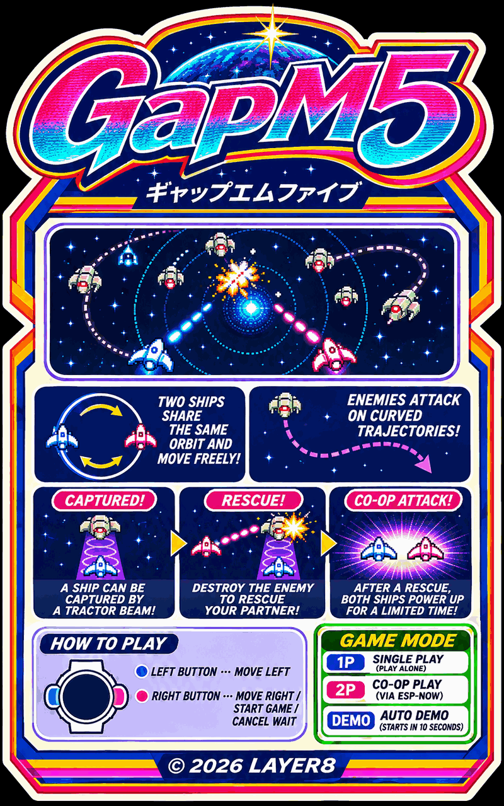

<div align="center">



# GapM5 — ギャップエムファイブ

**Co-op rescue shooter for two M5Stack StopWatch devices over ESP-NOW**

[日本語 README](README_JA.md) · [Source license](LICENSE) · [Asset rights](ASSET_LICENSE.md)

</div>

## About the game

Two ships move in either direction on the **same circular orbital track**,
without passing through one another while both are active. They automatically
fire toward the center. Enemies emerge from the center on straight or curved
trajectories, disappear offscreen, and may dive back toward the center.
A tractor beam can capture one ship; its partner can shoot down the captor
to rescue it and trigger a cooperative power-up.

## Controls and demo

| State | Right physical button |
|:--|:--|
| Awaiting ESP-NOW partner | Start single-player |
| Connected to partner | Start co-op on both devices |
| Attract demo | Start a new game |
| Game over | Restart |

- **Left / right buttons while playing:** move around the circular track
- **No start input for 10 seconds:** automatic synchronized attract demo if paired, or solo demo otherwise
- **Both buttons held for 3 seconds:** force an AMOLED refresh (black-screen recovery)
- **Firing:** automatic, radially inward

**Both devices must run R8** for synchronized demo speed and identical visuals.
R8 retains R4's on-device AMOLED recovery that restored display on the second
StopWatch, as well as the host-authoritative ESP-NOW protocol (v2, 235 bytes).

## Build and flash (Windows, PlatformIO)

Hardware: M5Stack StopWatch / ESP32-S3R8, 16MB flash, 8MB PSRAM. PlatformIO
Espressif32 v6.12.0; M5Unified & M5GFX v0.3.0; `BOARD_ID=30`.

```bat
RUN_BUILD_ONLY.cmd
RUN_BUILD_FLASH_APP_ONLY.cmd COM13
```

Replace `COM13` with the **actual port on each device**. The flash helper reads
the device's real partition table and boot selection, then writes **only the
currently bootable APP partition**. It never erases NVS, otadata, SPIFFS,
bootloader or the partition table. Do not use `erase_flash`.

## Testing and status

- R4: AMOLED display recovery and ESP-NOW pairing confirmed on two physical StopWatch units by the project owner.
- R7/R8: Linux host C++ logic tests passed for curved enemy motion, co-op simulation and packet format.
- R8 ESP32-S3 build and physical two-device gameplay: **not independently verified for this release**.

## Licensing

**Original software source:** [MIT License](LICENSE), **Copyright © 2026 LAYER8**.
**Artwork / posters / original music:** © 2026 LAYER8, all rights reserved;
see [ASSET_LICENSE.md](ASSET_LICENSE.md). Dependency licenses are separate;
see [THIRD_PARTY_NOTICES.md](THIRD_PARTY_NOTICES.md).

GapM5 is an original project inspired by the feel of vintage space arcade games.
It is not affiliated with or endorsed by any historical game publisher.
