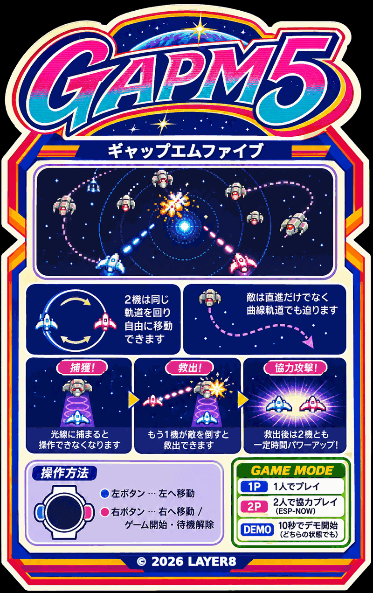

<div align="center">



# GapM5 — ギャップエムファイブ

**M5Stack StopWatchで遊ぶ、円周移動型のオリジナル協力レスキューシューティング**

[English](README.md) · [ソースのライセンス](LICENSE) · [画像・音楽の権利](ASSET_LICENSE.md)

</div>

## GapM5とは

2機の宇宙船が、**同じ円周軌道を左右どちらにも自由に移動**するシューティングです。
ただし、2機とも健在な間はお互いを追い越せません。中心に向かって弾を自動連射し、
中心奥から迫る敵を迎撃します。敵は直進だけでなく二次曲線で飛行し、
画面外へ消えてから再び襲ってくることもあります。

敵の捕獲光線で仲間が動けなくなったら、もう1機が捕獲した敵を撃破して救出。
**救出後は2機とも一定時間パワーアップ**します。協力して面クリアを目指しましょう！

## 操作方法

| 状態 | 右ボタン |
|---|---|
| 相手機を探しているとき | 1人用を開始 |
| ESP-NOWで2台接続したとき | 2人協力プレイを開始 |
| デモ中 | ゲーム開始 |
| ゲームオーバー | 再スタート |

- **プレイ中の左右ボタン：** 円周上を左右へ移動
- **射撃：** 中心へ向けた自動射撃
- **10秒間スタートしない場合：** 1人用または2人協力のデモが自動再生
- **捕獲と救出：** 捕獲された仲間を、もう1機が敵を倒して救出
- **デモ：** 追い越し禁止、協力攻撃、捕獲・救出を振動なしで紹介

2人用ではESP-NOWで直接通信するため、Wi-Fiルーターやインターネットは不要です。

## ビルド・書き込み（Windows / PlatformIO）

対象：M5Stack StopWatch（ESP32-S3、Flash 16MB、PSRAM 8MB）。

```bat
RUN_BUILD_ONLY.cmd
RUN_BUILD_FLASH_APP_ONLY.cmd COM13
```

`COM13` は接続したStopWatchのCOM番号に置き換えてください。
書き込みスクリプトは起動するAPP領域だけに書き込み、
ブートローダー、パーティション表、OTA設定、保存領域は消去しません。
インストールのための全消去は行わないでください。

## ライセンス・クレジット

- **オリジナルソースコード：** [MIT License](LICENSE) / Copyright © 2026 LAYER8
- **画像・インストカード・オリジナル音楽：** © 2026 LAYER8 / All rights reserved（[権利表記](ASSET_LICENSE.md)）
- **外部ライブラリ：** 各ライセンスに従います（[外部ライブラリ一覧](THIRD_PARTY_NOTICES.md)）

GapM5はオリジナル作品です。特定のゲームメーカーとの提携・公認関係はありません。
